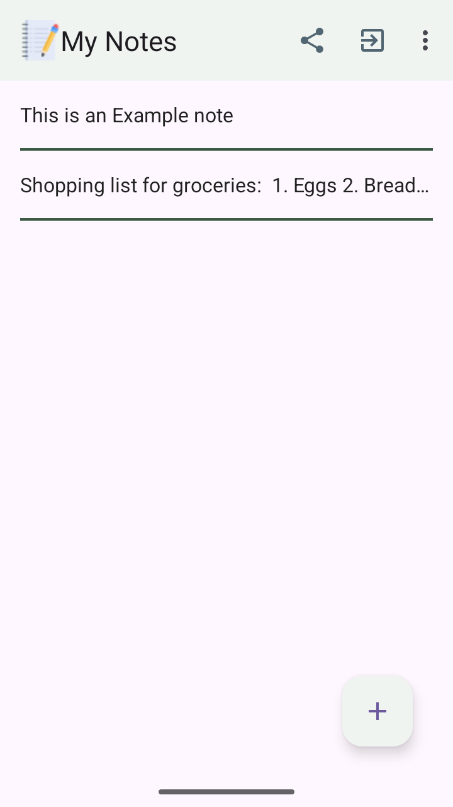
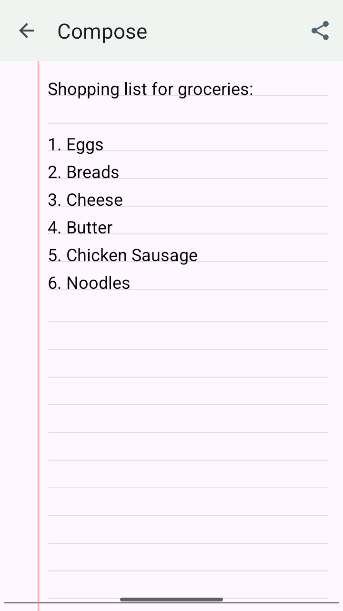
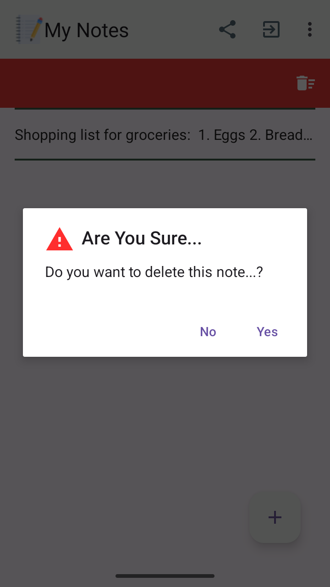

# My Notes 📝

**My Notes** is a simple, intuitive, and distraction-free Android application designed for everyday note-taking. Built with standard Android components and custom Canvas views, it offers a real notebook experience right on your device.

---

## ✨ Features

- **📓 Custom Lined Paper Canvas (`LinedEditText`)**
  - Custom custom-drawn `AppCompatEditText` view that renders horizontal page rules and vertical margins to mimic a physical lined notepad.
  - Supports dynamic line color, thickness, and margin line customizations, with automatic dark mode contrast adjustments.
- **⚡ Instant Real-Time Autosave**
  - Real-time text watcher automatically persists changes instantly to `SharedPreferences` as you write—ensuring you never lose a thought or idea.
- **🗑️ Swipe-to-Delete with Canvas Animations**
  - Smooth left-swipe gesture in the list powered by `ItemTouchHelper`.
  - Custom `Canvas` drawing renders a Material Red background with a centered delete icon and safety confirmation dialog.
- **📱 Clean & Scannable List**
  - Built using `RecyclerView` with custom row dividers and Material Floating Action Button (FAB).
- **📤 Sharing & Feedback Integration**
  - Share notes or app invite links easily.
  - Built-in feedback email launcher that automatically attaches app version and device hardware/OS diagnostic info.
  - Interactive "About Us" and update announcement dialogs.

---

## 🛠️ Tech Stack

- **Language:** Java 11
- **Target SDK:** 37 (Android 16)
- **Min SDK:** 26 (Android 8.0 Oreo)
- **Build System:** Gradle 9.4.1 with Gradle Version Catalog (`libs.versions.toml`)
- **UI Framework:** Material Design Components (`com.google.android.material`), AndroidX AppCompat, RecyclerView, ConstraintLayout
- **Custom Views:** Android `Canvas`, `Paint`, and custom styleable XML attributes (`attrs.xml`)
- **Data Persistence:** `SharedPreferences` with `HashSet` serialization

---

## 📁 Project Architecture

```
com.rd.mynotes/
├── MainActivity.java        # Main screen with RecyclerView, FAB, options menu, and swipe-to-delete
├── NoteEditorActivity.java  # Editor screen with real-time text watcher and back navigation
├── LinedEditText.java       # Custom View drawing notebook lines and margins on Canvas
├── NotesAdapter.java        # RecyclerView Adapter with custom click interface
```

---

## 📸 Screenshots

| Main Screen | Note Editor |                   Swipe to Delete                    |
| :---: | :---: |:----------------------------------------------------:|
|  |  |  |

---

## 🚀 Getting Started

### Prerequisites

- **Android Studio** Ladybug (2024.2.1) or newer recommended
- **JDK 11** or higher
- **Android SDK API 37** installed

### Building from Source

1. **Clone the repository:**
   ```bash
   git clone https://github.com/your-username/MyNotes.git
   cd MyNotes
   ```

2. **Open in Android Studio:**
   - Launch Android Studio and choose **Open an Existing Project**.
   - Select the `MyNotes` directory.

3. **Build the Debug APK:**
   ```bash
   ./gradlew :app:assembleDebug
   ```

4. **Run on Device or Emulator:**
   - Select your target device or emulator in Android Studio and press **Run** (`Shift + F10`).

---

## 📄 License & Attribution

Created with ❤️ by **Raj Initiatives**.

*Copyright © Raj Initiatives. All rights reserved.*
